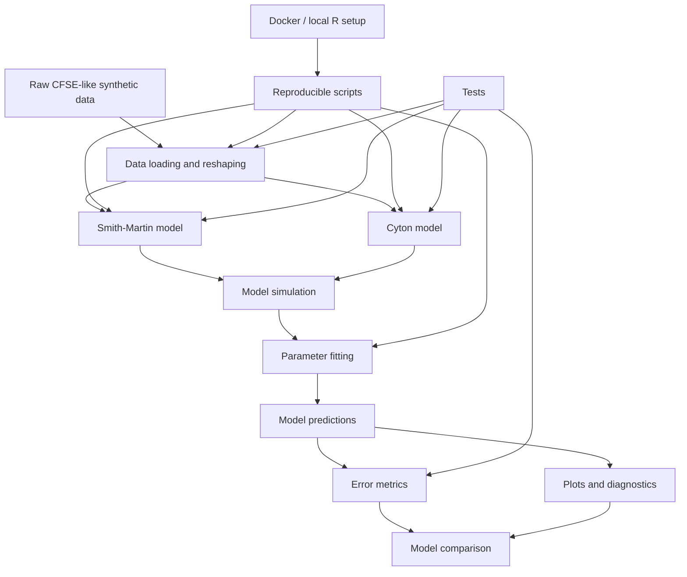

# T-cell proliferation models for CFSE-like data

Research code from my Master's project at the African Institute for Mathematical Sciences (AIMS Ghana):

> Chilperic Armel Foko Kuate. *Reverse-engineering of T cell proliferation dynamic*. AIMS Ghana, 2016.

This repository contains R implementations for simulating and fitting mathematical models of T-cell proliferation using CFSE-like generation-count data. The project connects mathematical biology, immune-cell population dynamics, parameter estimation, and reproducible scientific computing.

## Models

The repository focuses on two model classes used in the thesis:

* **Smith-Martin model** — generation-structured proliferation with delayed division dynamics.
* **Cyton model** — analytic proliferation model using exponential waiting-time assumptions for division and death.

The original thesis scripts are preserved in `legacy/original_R_scripts/`. The reusable implementation is organized in `R/`.

## What this repository demonstrates

This project documents an early stage of my research work in computational biology and mathematical modelling. It shows a complete research workflow connecting:

* biological assumptions,
* mathematical model formulation,
* simulation of CFSE-like synthetic data,
* parameter estimation,
* model comparison,
* reproducible implementation,
* restructuring of exploratory research code into a usable scientific codebase.

## Software architecture

The repository is organized as a reproducible modelling pipeline. The architecture separates data handling, model simulation, parameter fitting, evaluation, plotting, and execution scripts.



### Main components

| Component             | File(s)                                      | Role                                                                                       |
| --------------------- | -------------------------------------------- | ------------------------------------------------------------------------------------------ |
| Data layer            | `R/cfse_data.R`                              | Reads CFSE-like generation-count files and converts raw columns into model-ready matrices. |
| Smith-Martin model    | `R/smith_martin.R`                           | Simulates generation-structured T-cell proliferation with delayed division dynamics.       |
| Cyton model           | `R/cyton.R`                                  | Simulates the analytic Cyton model under exponential waiting-time assumptions.             |
| Fitting layer         | `R/fit.R`                                    | Provides utilities for fitting model parameters to observed generation-count data.         |
| Metrics layer         | `R/metrics.R`                                | Computes error measures such as SSD and average relative error.                            |
| Plotting layer        | `R/plot.R`                                   | Provides plotting helpers for model output and diagnostics.                                |
| Execution layer       | `scripts/`                                   | Contains runnable workflows for simulation, fitting, and comparison.                       |
| Reproducibility layer | `Dockerfile`, `tools/`, `.github/workflows/` | Provides Docker execution, local setup, project checks, and CI smoke testing.              |
| Provenance layer      | `legacy/original_R_scripts/`                 | Preserves the original thesis scripts without editing them.                                |

## Repository structure

```text
tcell-proliferation-models/
├── R/                         # core model, fitting, metric, and plotting functions
├── scripts/                   # executable workflows and examples
├── data/synthetic_cfse/        # synthetic CFSE-like datasets from the thesis project
├── legacy/original_R_scripts/  # original thesis scripts kept for provenance
├── tests/                     # lightweight checks for core functions
├── docs/                      # model notes and audit notes
├── tools/                     # setup and project validation scripts
├── .github/workflows/          # GitHub Actions smoke test
├── Dockerfile                 # reproducible R runtime
├── docker-compose.yml
├── INSTALL.md
├── DESCRIPTION
├── NAMESPACE
├── CITATION.cff
└── LICENSE
```

## Reproducibility

The repository includes a Docker-based R environment so the examples can be run without depending on a local R installation.

```bash
docker build -t tcell-proliferation-models:r-4.4.3 .
docker run --rm tcell-proliferation-models:r-4.4.3
```

For native Ubuntu/Debian installation:

```bash
chmod +x tools/install_r_ubuntu_24_04.sh
./tools/install_r_ubuntu_24_04.sh
```

Additional setup details are in `INSTALL.md`.

The reproducibility layer includes:

* Docker-based execution,
* local installation scripts,
* executable example workflows,
* lightweight tests,
* GitHub Actions smoke testing,
* preserved original scripts for provenance,
* included synthetic datasets,
* removal of private absolute paths from the reusable code.

## How to use the repository

From the repository root, run the example workflows:

```bash
Rscript scripts/01_simulate_smith_martin.R
Rscript scripts/02_simulate_cyton.R
Rscript scripts/03_fit_models.R
```

To use the functions interactively in R without installing the package:

```r
source("R/cfse_data.R")
source("R/metrics.R")
source("R/smith_martin.R")
source("R/cyton.R")
source("R/fit.R")
source("R/plot.R")
```

A typical workflow is:

1. Load CFSE-like generation-count data.
2. Select a model: Smith-Martin or Cyton.
3. Simulate generation trajectories for a chosen parameter set.
4. Fit model parameters against observed or synthetic data.
5. Evaluate the fit using error metrics.
6. Plot predictions and compare models.

## Minimal Smith-Martin example

```r
source("R/cfse_data.R")
source("R/metrics.R")
source("R/smith_martin.R")

observed <- read_cfse_counts(
  "data/synthetic_cfse/agent_based_sim_output_3.txt",
  max_generation = 20
)

times <- attr(observed, "times")

params <- c(
  lambda_0 = 1.870167e-02,
  lambda   = 3.422586e-02,
  d_0      = 1.000000e-03,
  d        = 3.425349e-02,
  delta    = 1.000000e-03
)

predicted <- simulate_smith_martin(
  params,
  times = times,
  max_generation = 20
)

ssd(observed, predicted)
```

## Minimal Cyton example

```r
source("R/cfse_data.R")
source("R/metrics.R")
source("R/cyton.R")

observed <- read_cfse_counts(
  "data/synthetic_cfse/agent_based_sim_output_1.txt",
  max_generation = 20
)

times <- attr(observed, "times")

params <- c(
  f0   = 1.000000e+00,
  f1   = 8.115505e-01,
  mu0d = 4.300041e+02,
  mud  = 2.341927e+01,
  mu0p = 5.316612e+01,
  mup  = 1.722716e+01
)

predicted <- simulate_cyton(
  params,
  times = times,
  max_generation = 20
)

ssd(observed, predicted)
```

## Data

The files in `data/synthetic_cfse/` are synthetic CFSE-like datasets generated during the thesis project using an individual-based simulation.

Each row corresponds to a sampled time point. Each generation has two columns, such as `N0d` and `N0p`; `read_cfse_counts()` converts them into total generation counts `N0`, `N1`, and so on.

## Scientific note

The Smith-Martin implementation uses the equation-consistent delayed survival convention by default. To reproduce the convention used in the exploratory thesis scripts, call:

```r
simulate_smith_martin(params, legacy_survival = TRUE)
```

This distinction is kept explicit because it affects the scientific interpretation of the model.

## Citation

If you use or refer to this repository, cite:

> Foko Kuate, C. A. (2016). *Reverse-engineering of T cell proliferation dynamic*. Master's thesis, AIMS Ghana.

Repository citation metadata is provided in `CITATION.cff`.

## License and provenance

This repository includes an MIT license. The original thesis scripts are preserved for provenance in `legacy/original_R_scripts/`. Before extending or redistributing legacy components, check authorship comments in the original files.
